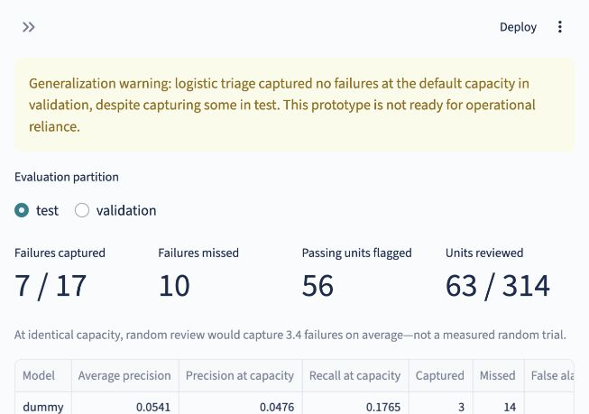

# Manufacturing quality triage — SECOM

**A retrospective engineering-review prototype, not a factory deployment.** Prioritize units associated with failed quality tests, inspect the model's evidence, and draft unit/batch briefs using a local LLM. Public SECOM data is **not Seagate data**.

## The question

With capacity to review only 20% of a historical production population, how many failed units can a model capture, how many passing units does it flag, and can its evidence be translated into a traceable investigation brief?

The 20% capacity is an illustrative, predefined policy—not a Seagate operational requirement. Model outputs are **priority scores, not calibrated failure probabilities**. Units are ranked by score, with record ID resolving ties.

## What the project contains

- Official-source download, checksums, explicit label mapping, data-quality audit, dictionary, and frozen chronological splits.
- Training-only filtering/imputation/scaling; class-weighted logistic regression, random forest comparator, and dummy baseline.
- Review-budget evaluation, precision–recall curves, approximate bootstrap intervals, and transparent false alarms/missed failures.
- Exact additive logistic explanations, missingness evidence, and training reference distributions.
- Structured Ollama report composition with evidence-supported finding types, reference/predicate validation, one repair attempt, deterministic fallback, and SQLite audit/review logs.
- Streamlit review queue, performance, and methods views; CSV/Markdown exports; a hosted mode that never calls Ollama.

See [results](docs/results.md), [model improvement study](docs/model_development.md), [model and data cards](docs/model_and_data_cards.md), [summary evaluation](docs/summary_evaluation.md), and [application talking points](docs/application_handoff.md). **No public site has been deployed; hosting is paused while model quality is investigated.** The development study is not promoted into the frozen queue.



Local browser and automated dashboard checks were completed; full desktop/mobile visual acceptance and end-user brief review remain unfinished.

## Run the included demo

### Current improvement work

The [budget-aligned study](docs/budget_improvement.md) fixes experimental missingness treatment, uses whole-timestamp folds and selects converged candidates by recall at 20% workload. The chosen 20-feature logistic captures 3/11 development failures versus v1 logistic's 0/11, but only matches the original forest and is **not promoted**. Run `triage improve-budget` in a separate checkout with official raw files and no existing `artifacts/v3_budget_verified` output; the published v1 dashboard remains frozen.

Python **3.11** is the tested runtime. No model download or source-data download is needed to explore the committed demo artifacts.

```bash
python3.11 -m venv .venv
source .venv/bin/activate
pip install -r requirements.txt
APP_MODE=hosted streamlit run app.py
```

Hosted mode displays saved drafts or explicitly labeled templates. It does not connect to a visitor's machine, perform inference, or write review logs. A saved AI draft is not a live generation and remains unreviewed until a person approves it.

## Generate briefs locally

Install [Ollama](https://ollama.com/), start its loopback server, and install `qwen3:8b` if needed. Model weights have their own license; this repository does not redistribute them.

```bash
ollama serve
# In another terminal, only if not installed:
ollama pull qwen3:8b
APP_MODE=local streamlit run app.py
```

The app sends only bounded, computed evidence to `http://127.0.0.1:11434`. No historical labels are included in the LLM bundle. Local approval/rejection is a review record, not an engineering action. Do not expose the local app or Ollama server to the Internet.

## Reproduce the analysis

The published run is frozen. To reproduce from scratch, use a separate fresh checkout without the generated artifacts directory (move that exact directory to a backup; do not discard the original run), then:

```bash
pip install -e .
triage download
triage train
triage evaluate
triage evaluate-summaries --live
triage build-demo --live
pytest -q
```

`train` refuses to overwrite an existing frozen run. `evaluate` returns existing results rather than reselecting a policy. For offline testing of briefs, omit `--live`; generated output is labeled as a template. The dashboard never trains models on refresh.

Raw downloads, trusted locally generated joblib models, the virtual environment, and SQLite logs are ignored by Git. Do not load joblib files from untrusted sources. The committed artifacts include public-data-derived scores, explanations, histograms and evaluation results for a lightweight demo.

## Architecture

```text
UCI files → audit + split manifest → training pipelines → frozen scores
                                      ↓                       ↓
                               model explanations → evidence bundle
                                                       ↓
                                        Ollama → checks → draft / fallback
                                                       ↓
                                      review log + Streamlit + exports
```

`triage` is a Python package and CLI. `app.py` reads versioned artifacts. Pydantic contracts define `EvidenceBundle`, `InvestigationBrief`, and `GenerationRecord`. Cache identity includes the population/evidence hash, prompt version, and model digest; changing scope cannot reuse a stale brief.

## Deploy

In [Streamlit Community Cloud](https://share.streamlit.io/), connect this GitHub repository, select branch `main`, entrypoint `app.py`, and Python 3.11. Default `APP_MODE` is `hosted`; leave it that way. No secrets, model server or paid API are required. Deployment requires your Streamlit/GitHub account authorization. Do not claim a live demo until the deployment is verified.

## Limitations and industry relevance

- The source has 1,567 records, 590 raw measurements and 104 failures. UCI's catalog lists 591 features; the implementation validates the actual raw shape.
- Sensor meanings, physical units, and measurement availability before the final test are undocumented. This is **retrospective quality classification**, not proven early warning or physical diagnosis.
- Small failure counts, old data, correlations, missingness and temporal shifts limit generalization. Bootstrap intervals do not eliminate these limits.
- An LLM's valid JSON and citations do not prove semantic correctness. Generated briefs require human review; physical remedies and autonomous decisions are prohibited.
- After free-prose testing exposed semantic errors, v2.1 restricts Ollama to selecting/ordering supported finding codes and checks; Python renders the facts and fixed interpretation wording. This is a deliberate safety tradeoff, not an unrestricted chatbot.
- Seagate's [historical Project Athena case study](https://www.seagate.com/www-content/enterprise-storage/it-4-0/images/cs595-1-1901-seagate-athena.pdf) describes AI-assisted wafer-defect inspection for HDD head manufacturing. This project transfers the review-workflow idea—not Athena's data, vision models, or internal technology.

## Attribution

McCann, M. & Johnston, A. (2008). **SECOM**. UCI Machine Learning Repository. [DOI:10.24432/C54305](https://doi.org/10.24432/C54305). Dataset and derived data: **CC BY 4.0**; code: MIT. The dataset is unmodified in ignored raw downloads; documented preprocessing, splits, models and derived artifacts are this project's transformations. See `artifacts/provenance.json` for exact source URLs/checksums.

Technical references: [scikit-learn leakage guidance](https://scikit-learn.org/stable/common_pitfalls.html), [Ollama structured outputs](https://docs.ollama.com/capabilities/structured-outputs), [Ollama thinking controls](https://docs.ollama.com/capabilities/thinking).
